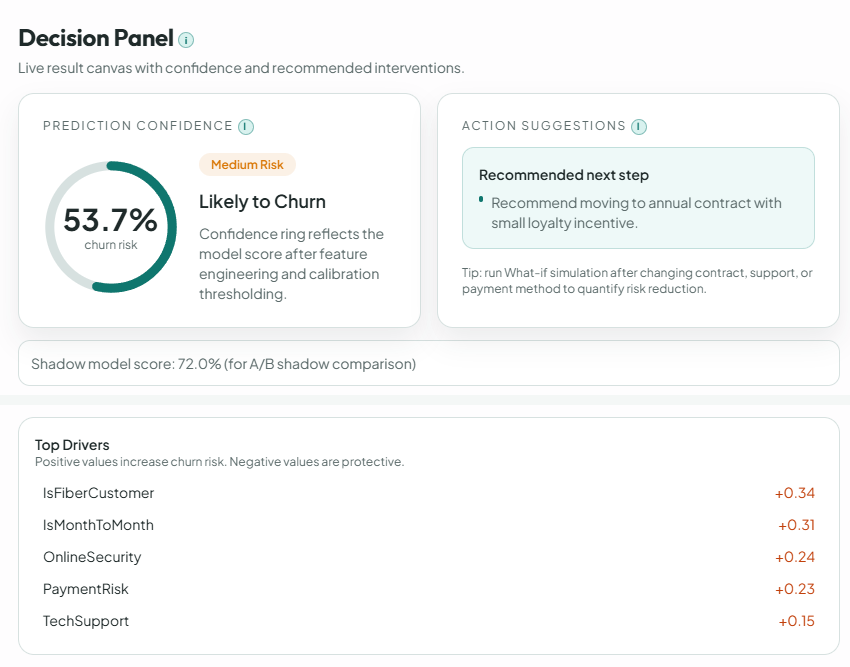
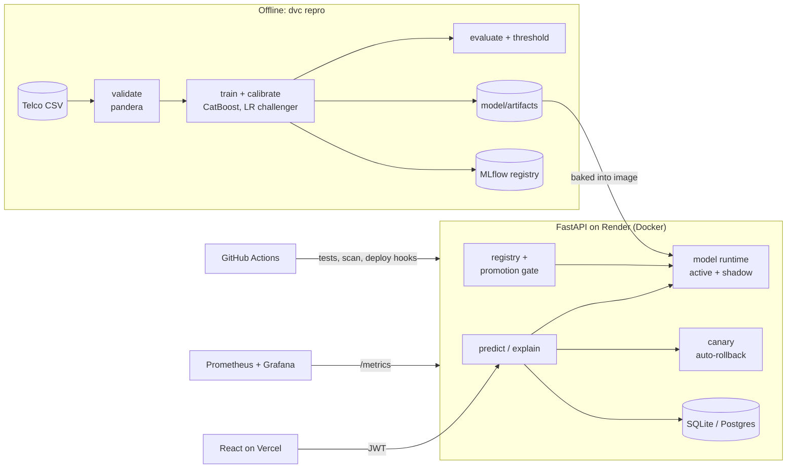

# Customer Churn Predictor

Churn scoring service with calibrated probabilities, a decision threshold derived from stated
costs, and a model lifecycle (shadow, canary, gated promotion, automatic rollback) that is tested
end to end.

[](https://github.com/akhilgolepu/Customer-Churn-Prediction/actions/workflows/ci.yml)
[](https://github.com/akhilgolepu/Customer-Churn-Prediction/actions/workflows/security.yml)
[](https://customer-churn-prediction-alpha-one.vercel.app)

**Try it:** [live app](https://customer-churn-prediction-alpha-one.vercel.app) ·
[API docs](https://customer-churn-prediction-4pvg.onrender.com/docs) ·
[end-to-end demo transcript](docs/demo_all.md)

Sign in as **Analyst** (password `demo-analyst789`) or **Viewer** (`demo-viewer789`); these demo
logins are public by design. The API runs on a free Render instance that sleeps when idle, so the
first request can take about a minute.



## What it does

- **Predict, explain, recommend.** `POST /predict` returns a calibrated churn probability and a
  contact / no-contact decision; `/explain` returns the SHAP drivers; `/recommend` picks retention
  actions within a budget using rule-based impact scores (heuristic, not learned).
- **Decides with a stated cost model.** The threshold (0.38) is chosen on validation data from an
  assumed offer cost, save rate and margin, not left at 0.5.
- **Manages model versions safely.** Register, shadow, canary, promote through a gate that fails
  closed (HTTP 409 on a worse candidate), and roll back automatically when a canary disagrees too
  often with the active model.
- **Monitors itself.** Input and score drift alerts, a retraining trigger, Prometheus metrics and a
  provisioned Grafana dashboard.

## Results

All numbers are measured on the IBM Telco data (7,043 customers; stratified 60/20/20 split, seed 42)
unless stated. Early stopping, calibration and the threshold are chosen on the validation split; the
test split is scored once. Each figure links to the file that produced it, and
[a test](backend/tests/test_readme_claims.py) fails if this page drifts from those files.

**Model comparison, 5-fold CV on train+validation (mean [95% t-interval])**
([docs/model_comparison.md](docs/model_comparison.md), `python model/training/evaluate.py`)

| Model | ROC-AUC | Brier |
|---|---|---|
| Logistic regression | 0.8484 [0.8375, 0.8594] | 0.1339 [0.1289, 0.1389] |
| CatBoost (served recipe) | 0.8476 [0.8351, 0.8601] | 0.1341 [0.1290, 0.1391] |
| LightGBM | 0.8451 [0.8309, 0.8593] | 0.1355 [0.1297, 0.1414] |
| CatBoost minus logistic regression, paired bootstrap | -0.0008, 95% CI -0.0034 to +0.0018 | +0.0002 [-0.0011, +0.0013] |

On Telco, CatBoost **does not beat** logistic regression. The served model scores test ROC-AUC
0.846 (95% CI 0.824 to 0.868) with calibration error ECE 0.018; the logistic regression runs beside
it as a standing challenger ([ADR 0001](docs/decisions/0001-catboost-active-logreg-challenger.md)).

**Second dataset: where the tree model wins** ([docs/second_dataset.md](docs/second_dataset.md),
`python model/training/second_dataset.py`). On a 10,000-customer bank churn dataset (OpenML 46911)
CatBoost beats logistic regression by +0.109 (95% CI +0.099 to +0.120) in CV ROC-AUC. Adding two
non-linear terms (a spline on age, one-hot product count) to the logistic regression cuts the gap to
+0.0225, so most of the advantage is two non-linearities the linear model misses.

**Decision threshold** ([docs/threshold_analysis.json](docs/threshold_analysis.json),
[ADR 0004](docs/decisions/0004-cost-based-threshold.md), `python model/training/threshold_analysis.py`).
Assumed: a $50 retention offer, a 30% save rate, and a saved customer worth 12 months x $74.86 mean
monthly charge x 50% margin = $449.16. The threshold chosen on validation is 0.38; the closed-form
break-even is 0.371. On test it gains +$716 per 1,000 customers over 0.50, with a 95% CI of
-$421 to +$1,888: **not statistically significant**.

**Load** ([docs/loadtest_results.md](docs/loadtest_results.md), raw CSVs in [docs/loadtest/](docs/loadtest/),
`python tasks.py loadtest --users 100 --workers 2`). Locust on the same desktop (Intel i5-14400F,
16 logical CPUs), 4 `/predict` : 1 `/explain`, every request scored by both models. About 290 req/s with 2 workers, 178 with 1 at
100 users; p95 18 to 25 ms at 20 users. Not measured on the deployed host.

## Architecture



Training runs offline and writes versioned artifacts that are baked into the API image, so serving
needs no training data. Each request is scored by the active model and, when one is loaded, by the
shadow; the canary counts how often their decisions differ and rolls the candidate back past a limit.
The registry (SQLite by default, Postgres supported) records which version is active, and the
runtime reloads it on restart. Details: [docs/architecture.md](docs/architecture.md); the reasoning
behind each choice: [docs/decisions/](docs/decisions/).

## Status: what is verified and what is not

| Component | Status | Evidence |
|---|---|---|
| Live deployment (Render + Vercel) | Verified | `scripts/verify_deployment.py`: 7/7 checks as analyst and viewer on 2026-10-20 |
| Test suite, SQLite | Verified | 197 tests locally (196 + 1 skipped in CI, which has no dataset); CI job "Backend Checks" ([docs/mlops.md](docs/mlops.md#ci)) |
| Test suite, Postgres 16 | Verified | Same suite, CI job "Backend Tests on Postgres" and locally against the compose Postgres |
| Golden predictions of the served model | Verified | 500-row synthetic sample pinned to 1e-6 (`backend/tests/test_ci_sample.py`) |
| Promotion gate, canary rollback, drift alert | Verified | `python tasks.py demo`, [transcript](docs/demo_all.md) |
| Training pipeline | Verified | `dvc repro` reproduces the model and evaluation outputs ([docs/mlops.md](docs/mlops.md#reproducible-pipeline-dvc--mlflow)) |
| API and frontend containers | Verified locally | `docker compose up --build`; see [docs/mlops.md](docs/mlops.md#running-locally) |
| Prometheus + Grafana | Verified locally | [screenshots](docs/mlops.md#observability-prometheus--grafana) |
| Devcontainer | Not verified | Written, never built |
| Load on the deployed host | Not measured | Only the local desktop numbers above |
| Business impact | Not measurable | Public data, no real outcomes or holdout group |

## Quickstart

Python 3.13. The demo needs the IBM Telco CSV at `data/Telco-Customer-Churn.csv` (not committed; no
DVC remote). The tests do not need it.

```bash
python tasks.py setup    # .venv + requirements.txt (one pinned file for API, CI and training)
python tasks.py demo     # predict, explain, gate, canary rollback, drift alert; about 40 s
python tasks.py test     # full test suite with coverage
```

Docker, Postgres, the frontend and observability: [docs/mlops.md](docs/mlops.md#running-locally).
Deployment, API reference and configuration: [docs/deployment.md](docs/deployment.md).

## Limitations

- **One process only.** The loaded models and canary counters live in each process, so with several
  uvicorn workers a promote or rollback switches only the worker that handled it until the others
  restart. Several workers would need a shared model-version signal
  ([ADR 0003](docs/decisions/0003-sqlite-by-default.md)).
- **The live demo forgets.** The free Render instance keeps SQLite on an ephemeral disk: prediction
  history, the audit log and registry changes reset on every deploy or restart.
- **No real outcomes.** Telco is a public benchmark; the save rate and margin behind the threshold
  are assumptions, and only a randomised holdout campaign could measure them.
- **The canary measures divergence, not correctness.** A better model also disagrees; deciding which
  is better needs labelled outcomes ([ADR 0002](docs/decisions/0002-canary-disagreement-over-compared-requests.md)).
- **Five HIGH vulnerabilities remain in the image** (transitive: cryptography, setuptools,
  urllib3; fixes exist, 0 CRITICAL), and the image is 3.22 GB because it installs the full
  dependency set ([docs/mlops.md](docs/mlops.md#ci)).
- **Retraining uses a simpler recipe** than `train.py` (no calibration file, a different pre-check);
  moving it onto the DVC pipeline is the next step.

<details>
<summary>Resume bullets and interview questions</summary>

Resume bullets with the command behind each number, likely interview questions with short answers,
and the bugs worth talking about: [docs/interview_notes.md](docs/interview_notes.md). All 32 issues
found while hardening the project: [docs/engineering_log.md](docs/engineering_log.md).

</details>

## Repository map

```
backend/          FastAPI service: routers, services (registry, canary, gate, drift), repositories, tests
model/            training pipeline (model/training/), calibration, preprocessing, shipped artifacts
frontend/         React + TypeScript dashboard (Vite, deployed on Vercel)
data/             dataset catalog, synthetic CI sample + golden predictions (Telco CSV via DVC)
docs/             results, architecture, decisions (ADRs), model card, demos, engineering log
scripts/          end-to-end demos, CI sample builder, deployment check
loadtest/         Locust scenario      observability/   Prometheus + Grafana provisioning
notebooks/        exploratory notebook reports/         DVC metrics and data-validation report
dvc.yaml, params.yaml   pipeline and its settings      tasks.py, Makefile   task runner
```
