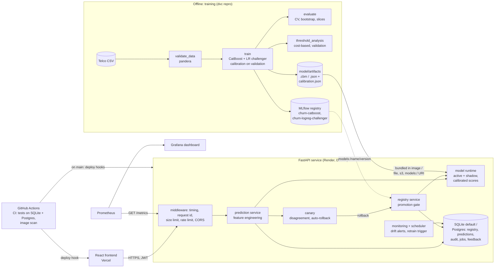
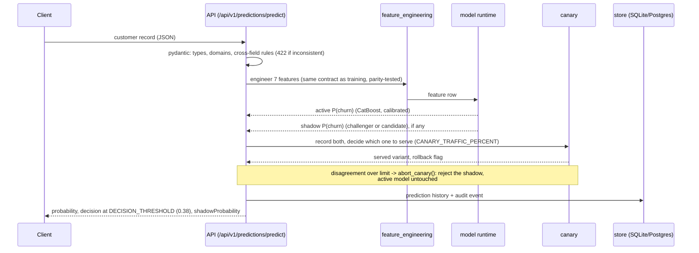

# Architecture

## System

The model artifacts ship inside the API image, so the service needs no training data
to serve. Training, evaluation and the threshold analysis run offline and write their
outputs back into the repository (`dvc.lock` records the hashes).

## A prediction request

## Model lifecycle

| Step | Endpoint / code | Guard |
|---|---|---|
| Train | `dvc repro` (`model/training/train.py`) | data validation stage, test split never used for selection |
| Register | `POST /api/v1/models/register` (file, s3, az or `models:/` path) | admin role |
| Shadow / canary | `POST /api/v1/models/shadow` | disagreement-based automatic rollback ([ADR 0002](decisions/0002-canary-disagreement-over-compared-requests.md)) |
| Promote | `POST /api/v1/models/promote` | promotion gate: 409 on blockers, audited override ([ADR 0005](decisions/0005-promotion-gate-fails-closed.md)) |
| Roll back | `POST /api/v1/models/rollback` | restores the last archived model |
| Restart | app startup | runtime loads what the registry says; refuses to start if the active artifact is missing |

The standing logistic-regression challenger occupies the shadow slot whenever no other
candidate is being tested ([ADR 0001](decisions/0001-catboost-active-logreg-challenger.md)).

## Code map

| Path | Role |
|---|---|
| `backend/routers/api_v1/` | HTTP routes (auth, predictions, models, jobs, system) |
| `backend/services/` | prediction, registry + promotion gate, canary, monitoring, drift (Evidently), jobs/scheduler, retraining, auth |
| `backend/repositories/` | SQLite and Postgres implementations of the same repository interfaces |
| `backend/model_loader.py` | runtime: CatBoost and linear adapters, calibration, bundles, MLflow URIs |
| `backend/core/prometheus.py` | `/metrics` |
| `backend/db/alembic/` | Postgres migrations `0001` to `0004` |
| `model/` | shared feature contract, calibration, linear model export, data schema, MLflow helpers |
| `model/training/` | `train.py`, `evaluate.py`, `threshold_analysis.py`, `second_dataset.py`, `permutation_check.py` |
| `scripts/` | demos (`demo_all.py`, rollback, drift), CI sample generator, deployment check |
| `observability/` | Prometheus config, Grafana provisioning and dashboard |

## How I would run this with real data

This project runs on a public benchmark with no outcomes. With a real customer base,
these are the parts that would change, in order of importance.

**Outcome labels.** Churn has to be defined before anything is trained: for example
"cancels or does not renew within 90 days of the scoring date". That definition
fixes the label delay (a prediction made today is labelled about 90 days later),
which in turn decides how fresh any evaluation can be. Training rows must be built
"as of" the scoring date, using only data available then, or the model learns from
the future. Outcomes would flow back through `POST /predictions/outcome` (or a
nightly batch join), keyed by prediction id, so every score can later be paired with
what happened.

**A control group, or the threshold means nothing.** The cost model assumes a save
rate for contacted churners. That number can only be measured with a randomised
holdout: some high-risk customers are deliberately not contacted. Without it, a
falling churn rate cannot be separated from the campaign's effect, and the threshold
analysis keeps resting on an assumed 30%. I would hold out about 10% of flagged
customers per cycle, and re-run `threshold_analysis.py` with measured offer costs,
save rates and margins.

**Retraining cadence.** Scheduled monthly retraining via the DVC pipeline (not the
simplified `retraining_service.py`), with drift alerts only bringing a run forward.
Each run trains on a rolling window, is evaluated on the most recent fully labelled
month (a time-based split, not a random one), passes the promotion gate against the
current model on that same month, then spends at least a week in shadow before
promotion. The gate's evaluation data would be that recent labelled month, not the
training CSV.

**Monitoring.** Four layers, from fastest to slowest signal:

1. Service health: latency, errors, throughput (`/metrics`, Grafana).
2. Input and score drift: the live monitor and Evidently, as in the demo. These fire
   immediately but only say "the population changed", not "the model got worse".
3. Calibration and ranking on labelled outcomes: once labels arrive, the realised
   churn rate per score band against the predicted probability, and AUC per month.
   This is the signal that should trigger retraining.
4. Business outcome: churn rate and retained revenue in the contacted group vs the
   holdout, per campaign. This is the only measure of whether the system is worth
   running.

**Data and governance.** Postgres instead of SQLite (persistent prediction history
and audit log, already supported and tested), monthly partitions for the event
tables, per-slice monitoring for the groups in the model card (seniors had lower
within-group AUC here), and a review of whether age-related features may be used
in retention decisions at all.
